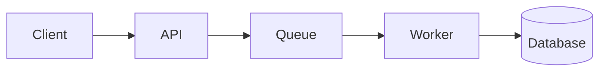

# Technical documentation

Builds on `software-architecture` (decision records, C4 diagrams) and `technical-design` (design docs). Frontend, backend, ai-engineering and game-development plugins apply it to their stacks. Review docs like code with `code-review`.

## Purpose and reader
- Before writing, name the reader and the task: the user later, a future AI session, an API consumer, whoever responds to an alert.
- Lead with what the reader needs to do or decide. Put background after.
- Write short, concrete, active sentences. Define terms once. One idea per paragraph.
- Record facts a future session cannot rediscover cheaply: decisions and reasons, commands that work, gotchas. If nothing durable would be captured, do not write the doc.

## Four kinds of docs
Keep them separate; mixing them confuses readers.
- Tutorial: learning by doing, a guided path to a working result for a beginner. Every step succeeds.
- How-to: steps to solve a specific problem for someone who knows the basics. Goal-titled ("Rotate a signing key").
- Reference: complete, accurate, terse facts (APIs, config, commands, error codes). Structured like the code, no narrative.
- Explanation: why it works this way: architecture, trade-offs, history. Links to decisions.

## README
- Order: what it is (one or two sentences), why it exists, quick start (copy-paste to a running result), usage example, configuration, development (build, test, lint), project layout, license.
- The quick start must work on a clean machine. State prerequisites and versions.
- Keep it short; link to deeper docs rather than inlining them.

## Docs as code
- Store docs in the repo, in Markdown, in the same change as the code they describe. A behavior change without a doc update is incomplete.
- Place docs near what they describe: module README beside the module, API docs generated from or adjacent to the contract, a `docs/` folder for cross-cutting material.
- Prefer generating reference from source of truth (schemas, types, CLI help) over hand-copying it.
- Lint links, spelling and formatting in CI. Fail on broken links.

## Examples that run
- Every code sample is complete enough to copy, minimal, and tested or compiled in CI where practical.
- Show expected output. Use realistic names, never real secrets or personal data (`secret-handling`).
- Pin versions in examples or state which version they target.

## API documentation
- Document each operation: purpose, inputs with types and constraints, outputs, errors and codes, auth, rate limits, idempotency, one request and response example.
- Document compatibility and deprecation policy. Mark deprecated items with the replacement and removal date.

## Runbooks
- Written to be followed under pressure: symptom, impact, how to confirm, step-by-step mitigation with exact commands, rollback, and how to verify recovery.
- Link each alert to its runbook. After each incident, update it.

## Diagrams as text
- Use Mermaid (or similar) in the repo so diagrams are diffable and reviewable.

- One purpose per diagram, labeled edges, no more than about a dozen nodes. Pick the right C4 level (`software-architecture`).

## Freshness
- Give each doc a last-reviewed date. Stale docs are worse than none; delete or archive them.
- Do not duplicate facts; link to the single source. Avoid hardcoding values that change (versions, URLs); reference where they live.
- Treat a reported doc error as a bug.

## Changelog vs docs
- A changelog records what changed per release for consumers: added, changed, deprecated, removed, fixed, security, with migration notes. Docs describe how things are now.
- Do not rely on the changelog to explain current behavior, nor docs to narrate history.

## Code comments
- Comments explain why: intent, constraints, trade-offs, workarounds with a reference. Code and names explain what.
- Delete comments that restate code or are outdated. Replace a comment with a better name or function where possible.
- Mark `TODO` with a tracked issue or date. Document public interfaces with concise doc comments: contract, units, failure modes.
